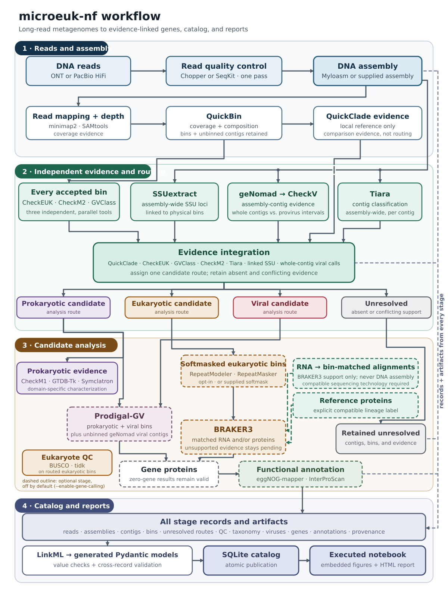

# microeuk-nf

microeuk-nf is a Nextflow workflow for ONT and PacBio HiFi metagenomes that
contain microbial eukaryotes, bacteria, archaea, and viruses. It performs
single-pass read QC, assembly, and binning. It screens every bin with CheckEUK,
CheckM2, and GVClass in parallel, classifies contigs with Tiara, and extracts SSU
loci and screens for viruses. Evidence-based routing then sends bins to
route-specific QC: BUSCO and tidk for eukaryotic candidates, and CheckM1,
GTDB-Tk, and Symclatron for prokaryotic candidates. Gene calling and functional
annotation are optional and off by default. Quality, taxonomy, RNA, and protein
evidence determine the gene-calling branches. The workflow writes a validated
SQLite catalog, native visualization bundles, an executed notebook, and an HTML
report.



*Candidate routes guide downstream analysis; they are not final taxonomy or
accepted MAG labels.*

The publication name is `microeuk-nf`. Established internal identifiers remain
`protist-meta-nf` for the Nextflow and Pixi workspaces, `protist-meta` for the
CLI, `protist_meta` for the Python package, and `protist-meta.sqlite` for the
catalog filename.

## Clone and prepare

```bash
git clone git@github.com:nelli-team/microeuk-nf.git
cd microeuk-nf
```

The clone is not a standalone full installation. `conf/databases.yaml` points to
local reference databases. The repository owns the Pixi workspaces for CheckM1,
CheckM2, GTDB-Tk, Symclatron (`envs/qc`), geNomad and CheckV (`envs/viral`),
Tiara (`envs/contig`), and BUSCO and tidk (`envs/eukqc`). CheckEUK, GVClass, and
SSUextract are frozen Git clones below `../protist-meta-runtimes/`, each pinned
to a verified commit. Configure the database paths for the target Dori
filesystem before a full run. The repository installers also retain fixed local
eggNOG and InterProScan setup paths.

Follow [Run and resume on Dori](docs/how-to/run-on-dori.md) for the ordered
environment setup and submission commands. Copy
[`data/samples.example.tsv`](data/samples.example.tsv) to a file of your choice,
edit its single row, and keep all 13 columns. Input paths are resolved relative
to that copied sample sheet.

Gene calling and functional annotation are off by default in full mode. Add
`--enable-gene-calling` to the allocation launcher to switch them on, and
`--skip-annotation` to retain gene models without functional annotation. Repeat
masking is a further opt-in (`--enable-repeat-masking`). The catalog and report
record the disabled stages and their reasons.

## Documentation

- [Source-scoped validation](SUMMARY.md) records accepted runs and scientific
  limits.
- [Scientific design](docs/explanation/design.md) explains the evidence and
  routing rules.
- [Input and dependency contract](docs/reference/inputs.md) defines the sample
  fields and local dependency boundary.
- [Report API](docs/reference/report.md) describes catalog reporting and
  interpretation.

Generated run outputs, validation receipts, and working notes are local
artifacts excluded from Git. The repository contains the reviewed source and
documentation; it does not claim a hosted documentation site.
