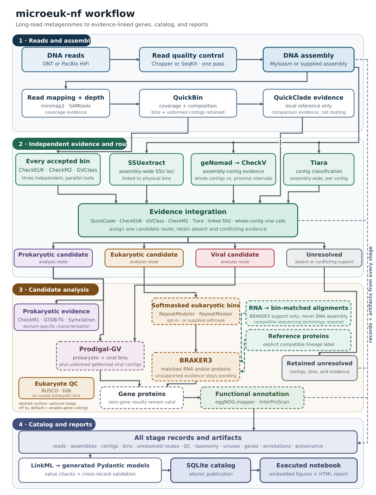

# microeuk-nf

microeuk-nf analyzes ONT or PacBio HiFi metagenomes that contain microbial
eukaryotes, bacteria, archaea, and viruses. It publishes independent quality and
taxonomy evidence, a validated SQLite catalog, an executed notebook, and an HTML
report.

<figure markdown="span">
  { width="1200" }
  <figcaption>Candidate routes guide downstream analysis; they are not final taxonomy or accepted MAG labels.</figcaption>
</figure>

microeuk-nf screens every bin with CheckEUK, CheckM2, and GVClass in parallel,
classifies contigs with Tiara, and routes bins on combined evidence. Eukaryotic
candidates get BUSCO and tidk QC, and prokaryotic candidates get CheckM1,
GTDB-Tk, and Symclatron. Gene calling and functional annotation are optional and
off by default.

The latest recorded ONT acceptance case completed 17 tasks and cached all 17 on
resume. Its catalog and report audits matched 18 record counts and 16 report
tables, and all 1,448 artifact hashes passed. Positive prokaryotic and
RNA-supported eukaryotic cases cover additional branches at their recorded
source revisions. All three records predate the 2026-11-10 upgrade. The
[source-scoped validation summary](https://github.com/nelli-team/microeuk-nf/blob/main/SUMMARY.md)
records the exact source revisions, counts, and interpretation limits.

- [Scientific design](explanation/design.md)
- [Run and resume on Dori](how-to/run-on-dori.md)
- [Input and dependency contract](reference/inputs.md)
- [Report API](reference/report.md)

Generated run outputs and full validation receipts are local artifacts excluded
from Git. This documentation is built locally; no hosted documentation
deployment is claimed.
